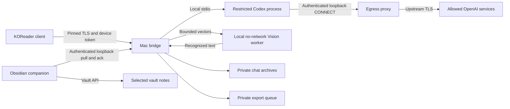

# Architecture

## Current components

The Mac bridge remains central. Questions and answers do not pass through Obsidian.
`bridge.mjs` implements model RPC orchestration, bounded chat state, and authenticated
reader routes; `server.mjs` configures TLS, restricted processes, archive storage, and
the optional companion service. The Node bridge is trusted host-side code; the Codex
process and OCR worker have separate restricted environments and sandboxes. See
[security and privacy](SECURITY.md) for those boundaries.

## Reading and conversations

Each book uses an opaque ID from native KOReader settings and has a separate model
thread, history, retry IDs, Stop, and reset. General/file-manager chat is independent.
IDs route conversations without sending book paths or PDFs. The cached native book
fingerprint is an invalidation hint, not a content-verified document identity.

`selection.lua` captures only selected text and numeric physical-page references.
Explain submits a preset request; Ask opens an editable draft and local attachment.
Follow-ups reuse the book conversation. The bridge retains concise visible questions
separately from the submitted context wrapper. Answers enter client snapshots only
when the turn completes, including interrupted or failed turns with partial text.

Working chats stay in memory. `archives.mjs` saves bounded per-book transcripts on
New chat or before reopening another archive, using atomic writes and per-book mutation
locks. Reopen displays saved text without a model call; an explicit follow-up supplies
bounded recent context to a fresh model thread. See [chats and archives](CHATS.md).

## Responsive client and rendering

`background.lua` runs pinned-TLS transport in a KOReader subprocess. Results cross an
anonymous pipe; bounded nonblocking reads and a watchdog keep network waits off the UI
thread. Workers balance standby locks, close file descriptors, and reap on completion,
cancellation, timeout, or exit. Request tickets discard stale callbacks; commands are
serialized and duplicate sends are suppressed.

The compact note preserves an editable composer, read-only history, drafts, and reader
location. Expand exposes handwriting and full controls. Closing the note does not cancel
an accepted model request. Closing during OCR prevents automatic submission and retains
recoverable text/ink within the reader instance. See [selection flow](SELECTION-FLOW.md)
and [reading UI](NOTE-UI.md).

Visible-text caching avoids formatting/repainting unchanged polls. Related changes are
coalesced to the next UI tick. Stable subwidgets can be repainted regionally when the
chat or its own keyboard is topmost and changed bounds do not overlap the keyboard.
Unknown geometry, popups, layout changes, and mode switches use conservative full-paint
paths. The read-only transcript restores a line anchor rather than an editing cursor.
Tests cover these contracts, not the physical e-ink controller. The unresolved artifact
and controls-only capture procedure are in [display troubleshooting](DISPLAY-ISSUE.md).

## Handwriting

The reader submits bounded pen vectors over its existing authenticated transport.
`recognition.mjs` runs a separately sandboxed Swift/Apple Vision helper with no network
or Codex-profile access. It rasterizes in memory and returns recognized text. Send
continues with text submission; preview does not start a model turn. See
[handwriting](../HANDWRITING.md).

## Obsidian delivery

`companion.mjs` exposes a separate authenticated API at `127.0.0.1:9444` when configured.
Its credential lives in Application Support and is distinct from the reader token.
The runtime retains only a nonsecret pairing-location pointer; archives and queued
exports remain in its private directory. No companion route forwards model RPC.

The bundled desktop plugin claims one vault, polls the queue, and creates snapshot
notes through the Vault API. It retains private planned/written receipts outside the
vault before acknowledging delivery. Deterministic export IDs and content hashes
support retry recovery without replacing user edits. Closing Obsidian pauses note
delivery while reading chat continues. The implemented import source is saved chat
archives; active-chat/individual-answer save actions on Kobo remain future work. See
[Obsidian integration](OBSIDIAN.md) and the [companion guide](../obsidian-kodex/README.md).

## Future document retrieval

No whole-book import, indexing, retrieval, scanned-page OCR, validated citation jumps,
or freehand PDF annotation is implemented. A future design would explicitly register
local documents, extract bounded page text in a restricted process, retrieve local
chunks by document identity, and attach bounded passages to a question through the
bridge. It must distinguish physical page indices from printed labels and validate
citations against supplied source IDs. The model would not gain general filesystem
access. Summaries spanning an entire book need separate coverage tracking rather
than an assumption that retrieval sees every page. See the [roadmap](ROADMAP.md).
