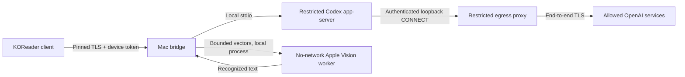
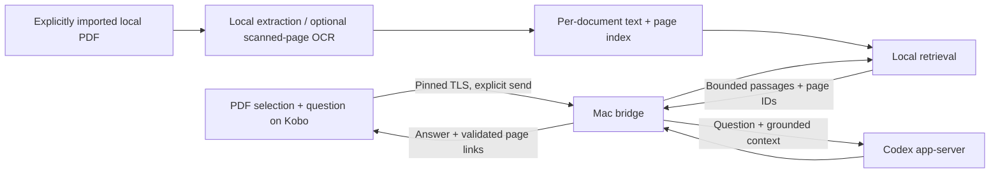

# Architecture

## Implemented: Kobo chat and handwriting

The 0.6.0 bridge owns an in-memory registry of separate document chats, plus an independent general chat for file-manager/legacy use. The previous 0.5.1 bridge used a single shared chat. Each document chat has its own model thread, history, retry IDs, Stop and reset. Native book settings store a random opaque identity; neither the PDF nor its path is sent for routing. Completed answers enter bounded client snapshots at once. The API is authenticated state, prompt, stop/reset, and asynchronous recognition. The Kobo client sends typed/recognized prompts and explicitly selected passage text, not arbitrary app-server RPC. Selection is carried inside the bounded text prompt, without document/file RPC. Recognition accepts only bounded numeric strokes; it cannot select files or URLs or call Codex. The prompt guard applies before text reaches the model. See DOCUMENT-CHATS.md for identity, limits, compatibility and ephemeral lifetime.

### Client 0.4.0: background transport

The Lua client runs the existing pinned-TLS request in a KOReader `ffi/util.runInSubProcess` worker. The child reads configuration, handles DNS/connect/TLS/HTTP, and parses JSON; it never changes widgets or device state. Results cross an anonymous pipe using LuaJIT's serializer, without temporary files or a modal trap widget. UI callbacks collect only immediately available bytes, at most 64 KiB per tick, with a 3.1 MB serialized-result limit and a 20-second watchdog. No blocking EOF reads or process waits run on the UI thread. Workers balance KOReader standby locks and close/reap on completion, cancellation, timeout, or application exit.

Chat opens from cached state before transport starts. A command supersedes a pending state poll; request tickets reject stale callbacks. Other commands are serialized, duplicate Send is suppressed, and Stop during Send is remembered until acknowledgment. The submitted draft remains editable and is only cleared if it still matches the acknowledged text; ink uses its version to preserve newer strokes. Closing chat leaves an already submitted command running but suppresses late popups/reopening. Closing during OCR cancels automatic submission and allows preview recovery on reopening. Model output is displayed only when the turn is no longer active.

The Lua/LuaJIT UI contracts cover delayed callbacks; the background integration test uses real POSIX subprocesses/pipes with a small `ffi/util` test shim. Hardware latency, standby behavior, and e-ink correctness are not established by these tests.

### Rendering 0.4.0: completed turns and bounded paints

Bridge snapshots retain the assistant slot but withhold its text while a turn is active. Completed, interrupted, and failed turns expose the assembled answer when the active flag clears. Prior completed messages remain visible. This reduces repeated transmission and decoding of hidden output without changing the state endpoint's shape. Snapshots still carry completed history; delta/history pagination is not implemented.

The client caches formatted visible messages and the joined transcript. Hidden deltas and unchanged polls do not reformat text, recreate the transcript, reset the title, or request a refresh. Control setters compare visible values; request completion transitions directly from sending to replying without rebuilding an intermediate idle title. A completed answer still needs one new transcript layout; per-message layout virtualization is not implemented.

Related transcript/title/action changes are coalesced until the next UI tick. The last whole paint records child geometry. With stable bounds and the chat topmost, changed subwidgets are explicitly repainted through KOReader's `widgetRepaint`, preceded by clearing their old rectangles. One non-flashing `ui` refresh covers the union of all writes; the parent is not dirtied by this path. Scrolling uses the same transcript-only path. A local ScrollTextWidget subclass suppresses its implicit parent refresh requests, and read-only scroll restoration uses lines rather than drawing a cursor. Pen contact/palm grace and popups defer regional painting; full paints, layout changes and closing consume/cancel pending work. Unknown or changed bounds fall back to the existing opaque whole-screen paint with matching refresh coverage. Opening, keyboard changes, rotation, popup dismissal and Clear retain their conservative paths.

The UI suite checks dirty/paint counts, covering refresh bounds, the pinned upstream scrollbar method, cached strings, scroll-back/draft preservation, deferral and stale-layout cancellation. It is not a pixel renderer or e-ink test. Verify both orientations, scrolling, reply completion, pen interaction and the unresolved right-edge defect on the actual Kobo before declaring the display behavior fixed.

### Note UI 0.5.0 (hardware acceptance pending)

Reading interactions now default to a compact InputDialog-based note with a focused native editor. Its read-only transcript is allocated only after history exists, above the active input. Font size is 18. Explicit assistant-body character ranges accompany the cached transcript; a local ScrollTextWidget subclass paints light gray highlights using native glyph geometry, clipped to the text bounds. The answer remains separate from the editable composer and still appears only once complete. Compact Send doubles as Stop, and Expand/Compact changes the same panel while preserving draft/cursor/ink. Handwriting stays in expanded mode.

Compact painting leaves the reader visible and refreshes only the frame or changed child regions; expanded painting retains screen-wide coverage. Reinitialization/mode changes redraw the underlying reader to restore uncovered pixels. See NOTE-UI.md for sizing, cursor behavior and tests. Device appearance and interaction require hardware acceptance. The full-screen layout is retained through Expand.

The native Codex process runs inside a mandatory macOS sandbox with a dedicated profile and temporary empty workspace. Shell/subprocess, unrelated files, direct LAN/Internet access and unexpected approvals are restricted. Its only permitted network path is an authenticated local proxy allowing the configured official OpenAI hosts on port 443, rejecting private/reserved DNS results. Existing protections and residual limitations are documented in the original README and historical security report. The bridge itself is trusted host-side code, not a VM.

The handwriting worker is separately sandboxed with no networking, no Codex profile access, and no raster files. Local recognition is not a promise that a prompt sent to Codex stays on-device: submitted prompt text is processed upstream.

## Implemented in 0.4.0: selection-first chat

Explain and Ask Codex are registered through ReaderHighlight's `addToHighlightDialog`; registration is deferred until reader initialization and removed on document close. Selection capture copies only text and numeric page endpoints before normal highlight-menu cleanup. Chat exposes the attachment separately from the question. Explain preserves existing composer text/ink and sends its preset; Ask composes locally and sends explicitly. A native reader-view snapshot is restored only if necessary, while the same document is still open. See SELECTION-FLOW.md for lifecycle, payload bounds, privacy and verification limits. On-device interaction/rendering acceptance is pending.

## Installed 0.7.0: chat archives

The bridge saves bounded per-book transcripts into a private directory outside the model sandbox only on New chat or when switching saved conversations. History lists contain metadata, while reopen reconstructs recent visible history and saves the displaced working chat first. A follow-up sends bounded saved context into a fresh ephemeral thread; no model thread persistence or broader tool permissions are introduced. Async atomic storage and per-book mutation locks protect against disk failures and request races. See CHAT-ARCHIVES.md for compatible bridge/plugin deployment requirements.

## Proposed next: whole-document PDF conversation

The Mac holds a user-imported PDF copy and a local index. The bridge, not an unrestricted Codex tool, retrieves passages. It attaches selected text, relevant surrounding/document passages and conversation history within explicit budgets. Existing model file access and shell permissions remain disabled. The current app-server has no retrieval/file tool exposure, so this is client-side orchestration to implement.

### Data model to implement

- Opaque `documentId` tied to a content hash and index version; device paths are not model context.
- Physical PDF page index plus optional printed page label, selection rectangles and normalized extracted text.
- Local chunks with document/page provenance, text offsets and stable chunk IDs.
- A conversation scoped to a document and explicitly attached selections; current prototype has one generic chat.
- Retrieval results labeled with permitted source IDs; the UI resolves citations through those IDs. Model-invented page numbers must not become trusted navigation links.

### Question flow

1. User selects text, chooses Explain/Ask, or explicitly enters Chat with this PDF.
2. Client sends opaque document identity, current page, selected passage and question. It preserves the reader's location.
3. Bridge retrieves from that document only, includes surrounding paragraphs when appropriate, and records the actual context budget/source IDs.
4. App-server receives bounded text context. It does not autonomously browse unrelated PDFs or files.
5. Bridge returns the answer and validated source links; the Kobo can jump back to a cited page.

### Privacy and correctness boundaries

Only explicit PDF imports are indexed. No automatic whole-library scan, full-PDF upload or extraction of adjacent books. Index/database/PDF storage stays local and outside Git. Retrieved text submitted for answering leaves the Mac through the existing upstream connection; make that visible in the product's send flow. Scanned-page OCR must use a separate explicitly scoped local path; the current vector recognizer is not a PDF parser.

Document content is untrusted evidence, not permission to run tools or alter the bridge's security rules. Bound extraction sizes, page counts, decompression/resources, request bodies, context and index retention. Parse PDFs in a restricted process. Authorize document IDs against registered local files; never accept arbitrary paths/URLs from Kobo or model output. Do not expand the egress allowlist for retrieval. Evaluate malicious PDFs, prompt injection, misleading retrieval and sensitive-text false positives.

Whole-document search is not whole-document comprehension on every turn. Retrieval can omit relevant evidence; expose insufficient evidence and cite sources. Whole-book summaries/comparisons require a separate section-by-section pass with coverage tracking. Distinguish printed page numbers from physical PDF indices, and test rotations/crops/reflow when mapping selections and jumps.

## Obsidian companion preview

The bridge remains the only route from the Kobo to Codex. `companion.mjs` optionally
serves a separate loopback-only API on `127.0.0.1:9444`, authenticated with a private
companion credential rather than the Kobo token. It provides an archive metadata
catalog, explicit snapshot/sample enqueue, destination claim, pending delivery, and
acknowledgment. It exposes no model RPC. Queue files stay in `.private/`; companion
credentials live in Application Support, referenced by a nonsecret runtime pointer.
The Obsidian plugin never accesses the runtime's Documents directory for pairing.

The Obsidian desktop plugin in `obsidian-kodex/` pulls queued snapshots, creates
notes through the Vault API, and records durable receipts outside the vault before
acknowledging delivery. Closing Obsidian delays note delivery without affecting chat.
The plugin is bound to one claimed vault and never scans unrelated vault notes.
See [Obsidian integration](OBSIDIAN.md) for ownership, limits, and remaining work.

## Optional later work

Freehand PDF ink is separate from selection highlighting and from the chat's pen pad. If added, store local page-coordinate strokes, preserve original PDFs, and explicitly export annotated copies. Do not automatically send annotations or page images to Codex.
