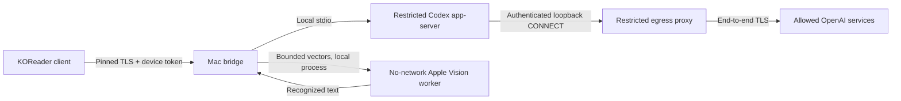
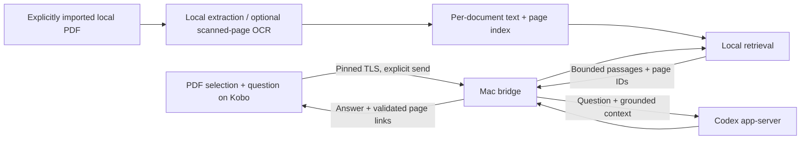

# Architecture

## Implemented: Kobo chat and handwriting

The bridge owns a single chat state and polls/streams app-server events into a bounded client snapshot. The current API is authenticated state, prompt, stop/reset, and asynchronous recognition. The Kobo sends typed/recognized prompts, not arbitrary app-server RPC. Recognition accepts only bounded numeric strokes; it cannot select files or URLs or call Codex. The prompt guard applies before text reaches the model.

The native Codex process runs inside a mandatory macOS sandbox with a dedicated profile and temporary empty workspace. Shell/subprocess, unrelated files, direct LAN/Internet access and unexpected approvals are restricted. Its only permitted network path is an authenticated local proxy allowing the configured official OpenAI hosts on port 443, rejecting private/reserved DNS results. Existing protections and residual limitations are documented in the original README and historical security report. The bridge itself is trusted host-side code, not a VM.

The handwriting worker is separately sandboxed with no networking, no Codex profile access, and no raster files. Local recognition is not a promise that a prompt sent to Codex stays on-device: submitted prompt text is processed upstream.

## Proposed: selection-aware PDF conversation

The Mac holds a user-imported PDF copy and a local index. The bridge, not an unrestricted Codex tool, retrieves passages. It attaches selected text, relevant surrounding/document passages and conversation history within explicit budgets. Existing model file access and shell permissions remain disabled. The current app-server has no retrieval/file tool exposure, so this is client-side orchestration to implement.

### Data model to implement

- Opaque `documentId` tied to a content hash and index version; device paths are not model context.
- Physical PDF page index plus optional printed page label, selection rectangles and normalized extracted text.
- Local chunks with document/page provenance, text offsets and stable chunk IDs.
- A conversation scoped to a document and explicitly attached selections; current prototype has one generic chat.
- Retrieval results labeled with permitted source IDs; the UI resolves citations through those IDs. Model-invented page numbers must not become trusted navigation links.

### Question flow

1. User selects text, chooses Explain/Ask, or explicitly enters Chat with this PDF.
2. Client sends opaque document identity, current page, selected passage and question. It preserves the reader's location.
3. Bridge retrieves from that document only, includes surrounding paragraphs when appropriate, and records the actual context budget/source IDs.
4. App-server receives bounded text context. It does not autonomously browse unrelated PDFs or files.
5. Bridge returns the answer and validated source links; the Kobo can jump back to a cited page.

### Privacy and correctness boundaries

Only explicit PDF imports are indexed. No automatic whole-library scan, full-PDF upload or extraction of adjacent books. Index/database/PDF storage stays local and outside Git. Retrieved text submitted for answering leaves the Mac through the existing upstream connection; make that visible in the product's send flow. Scanned-page OCR must use a separate explicitly scoped local path; the current vector recognizer is not a PDF parser.

Document content is untrusted evidence, not permission to run tools or alter the bridge's security rules. Bound extraction sizes, page counts, decompression/resources, request bodies, context and index retention. Parse PDFs in a restricted process. Authorize document IDs against registered local files; never accept arbitrary paths/URLs from Kobo or model output. Do not expand the egress allowlist for retrieval. Evaluate malicious PDFs, prompt injection, misleading retrieval and sensitive-text false positives.

Whole-document search is not whole-document comprehension on every turn. Retrieval can omit relevant evidence; expose insufficient evidence and cite sources. Whole-book summaries/comparisons require a separate section-by-section pass with coverage tracking. Distinguish printed page numbers from physical PDF indices, and test rotations/crops/reflow when mapping selections and jumps.

## Optional later work

Freehand PDF ink is separate from selection highlighting and from the chat's pen pad. If added, store local page-coordinate strokes, preserve original PDFs, and explicitly export annotated copies. Do not automatically send annotations or page images to Codex.
